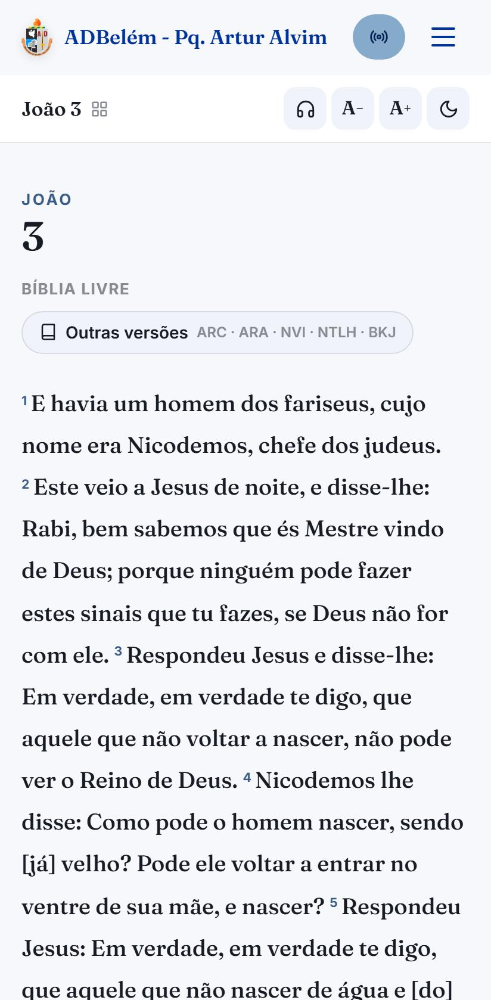
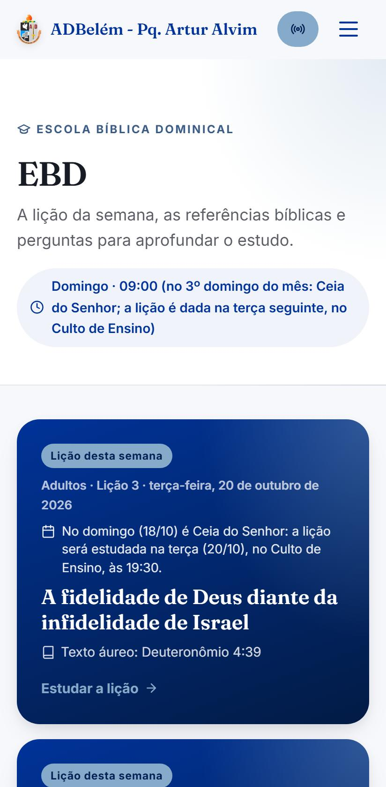
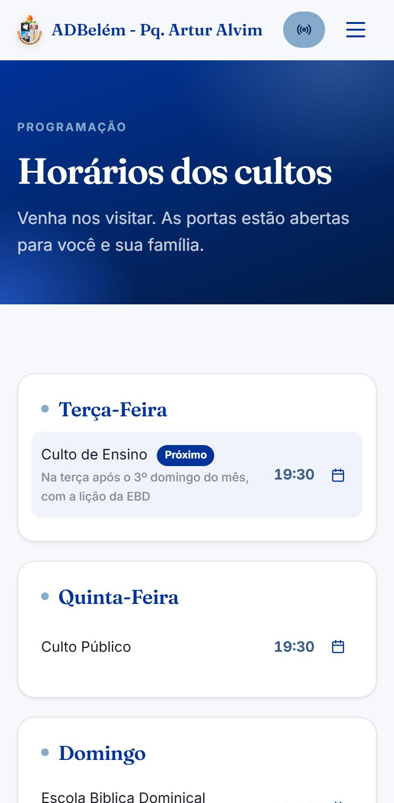
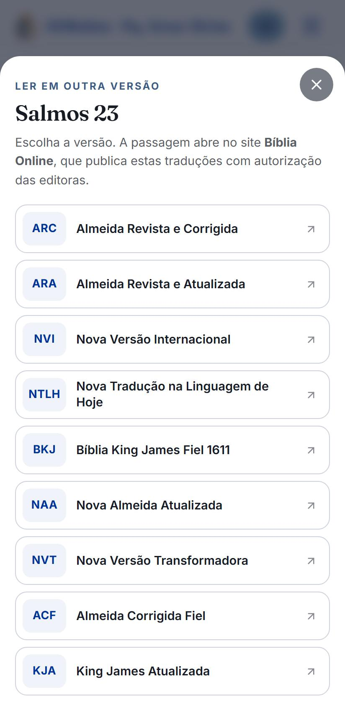
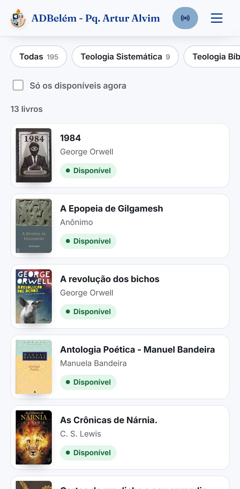

<p align="center">
  
</p>

<h1 align="center">Assembleia de Deus Belém – Parque Artur Alvim</h1>

<p align="center">
  Site e app da igreja: cultos, Bíblia, Escola Bíblica, Harpa Cristã, biblioteca, vídeos, pedidos de oração<br>
  e um painel para a equipe cuidar de tudo sem precisar de programador.<br><br>
  <a href="https://assembleia-de-deus-pq-artur-alvim.vercel.app"><strong>assembleia-de-deus-pq-artur-alvim.vercel.app</strong></a>
</p>

<p align="center">
  
  
  
  
  
</p>

## O que é

Um site em português, feito para o celular, que reúne a vida da igreja em um só lugar: horários dos
cultos, a Palavra, a lição da Escola Bíblica, os hinos, a biblioteca dos jovens, as transmissões e
os canais de contato. Pode ser **instalado como app** no Android e no iPhone, abre **sem internet**
o que já foi visto e se **atualiza sozinho**. Tudo o que muda no dia a dia (cultos, eventos, avisos,
lições, livros, vídeos, cores) é editado pela equipe num **painel administrativo** em `/admin`.

## O que o site oferece

### Para quem visita

| | |
| --- | --- |
| **Cultos e agenda** | Programação semanal com o **próximo culto calculado sozinho** (inclusive a Ceia do Senhor no 3º domingo do mês, quando a lição da EBD passa para o Culto de Ensino de terça), eventos, avisos e notícias. Qualquer culto ou evento vai para a agenda do celular (.ics / Google Agenda) com um toque. |
| **Bíblia Sagrada** | Bíblia completa no site (Bíblia Livre), busca por livro ou referência ("Jo 3.16", "Sl 23"), seleção de versículos para copiar, compartilhar ou gerar link, tamanho de letra e tema escuro, "continuar de onde parei" e leitura offline. O botão **Outras versões** abre a mesma passagem na ARC, ARA, NVI, NTLH, BKJ e outras. |
| **Palavra Diária** | Um versículo por dia para meditar, com os dias anteriores. |
| **Modo ouvir** | Lê em voz alta a Bíblia, a lição da EBD, a Palavra Diária e as notícias com a voz do próprio aparelho, com velocidade, destaque do trecho e continuação no próximo capítulo. |
| **Escola Bíblica Dominical** | Lição da semana de cada revista (Adultos, Jovens…), trimestres, texto áureo e leitura em classe com o texto bíblico, leitura diária para marcar, pontos principais, perguntas e link para a lição completa. |
| **Harpa Cristã** | Índice dos 640 hinos com busca por número ou nome, "Meus hinos" no aparelho e atalhos para ouvir e ver a letra. |
| **Biblioteca dos Jovens** | Acervo com busca e categorias, situação de cada livro (disponível, emprestado com data de volta, reservado), sinopse e pedido "Quero este livro" ou "Entrar na fila de espera". |
| **Vídeos e podcast** | Cultos e lives do YouTube atualizados sozinhos, busca e filtros, botão "Ao vivo" e player de podcast que continua tocando enquanto se navega. |
| **Comunidade** | Pedido de oração e contato (chega por e-mail à equipe), primeira visita (horários, endereço, como chegar), departamentos, história e liderança da igreja e ofertas por PIX com QR Code. |
| **App e privacidade** | App instalável (PWA) com atalhos, abertura animada com o brasão montado em formas geométricas, aviso de versão nova, política de privacidade (LGPD) e conteúdos de terceiros (YouTube, Spotify, Maps) só com permissão. |

<p align="center">
  
</p>
<p align="center">
  
  
  
  
</p>

### Para a equipe (painel em `/admin`)

- **Aparência:** cores, logo, foto e textos do topo e a frase da abertura.
- **Página inicial:** liga, desliga e reordena as seções da home.
- **Cultos:** dias e horários, com trocas mensais (ex.: Ceia do Senhor no 3º domingo).
- **Eventos, avisos, notícias, vídeos e podcast:** com publicação agendada e fotos enviadas pelo celular.
- **EBD:** trimestres e lições, com importação automática de títulos, datas e referências bíblicas, revisão e publicação.
- **Biblioteca:** empréstimos com as regras da biblioteca (limite por pessoa, prazo, renovação, suspensão por atraso), fila de espera, mensagens prontas no WhatsApp, acervo com capas, leitores e exportação para planilha.
- **Departamentos, sobre a igreja, primeira visita, igreja e redes, doações (PIX).**
- **Entrada protegida:** e-mail e senha **e** confirmação por e-mail (“Liberar acesso” / “Não fui eu”) a cada login.

## Como é feito

- **HTML, CSS e JavaScript puro**, sem framework e sem etapa de build.
- **Supabase**: banco Postgres com regras de acesso (RLS) por tabela, login do painel, armazenamento
  de imagens e uma função que busca os vídeos do YouTube.
- **Vercel**: hospedagem, funções do servidor (`api/`) e tarefa agendada diária.
- **Resend** para o e-mail dos pedidos de oração; **Web Speech API** para o modo ouvir;
  **service worker** para o app offline; abertura feita em CSS, SVG e canvas (sem vídeo).

## O que não está neste repositório

O `.gitignore` deixa de fora tudo o que é segredo ou dado da igreja:

- **Chaves e senhas**: ficam só nas variáveis de ambiente da Vercel (`RESEND_API_KEY`, `NOTIFY_TO`,
  `EBD_SYNC_TOKEN`, `CRON_SECRET`, `ADMIN_ACCESS_TOKEN`, `LIB_SHEET_ID`, `LIB_SYNC_TOKEN`,
  `LIB_TRIGGER_KEY`). A única chave no código é a **publicável** do Supabase, que é
  pública por natureza (veja "Segurança").
- **Cópias de segurança do banco** (`supabase/backups/`) e os ids do projeto na Vercel (`.vercel/`,
  `scripts/vercel-projeto.json`).
- Nomes e telefones da biblioteca e os pedidos de oração nunca ficam em arquivos: estão no banco,
  protegidos por RLS, ou vão direto por e-mail.

## Estrutura

```
index.html            casca da página (carrega CSS, JS e a tela de abertura)
vercel.json           rotas, cabeçalhos de segurança (CSP, HSTS…), cache, funções e agendamento
manifest.webmanifest  app instalável (PWA)
sw.js                 service worker: site abre sem internet
robots.txt, sitemap.xml
api/                  funções do servidor: contato.mjs (e-mail do formulário), ebd-sincronizar.mjs,
                      ebd-sync-diario.mjs (agendada), admin-acesso.mjs e admin-aprovar.mjs
                      (liberação do painel por e-mail) e _lib/ (modelos de e-mail, leitor da EBD)
scripts/publicar.sh   publica na Vercel (carimba a versão para o app se atualizar)
assets/img/           brasão em vetor (brasao.svg), ícones do app, imagem de compartilhamento
data/harpa/           índice da Harpa Cristã (número e título)
assets/fonts/         Fraunces e Inter (hospedadas aqui, sem Google Fonts)
data/bible/blivre/    Bíblia Livre: index.json + um arquivo por livro (veja LICENCA.txt)
vendor/               supabase-js e qrcode-generator em versões fixas (VERSIONS.txt)
css/
  fonts.css base.css intro.css site.css podcast.css extras.css bible.css ebd.css harpa.css
  biblioteca.css admin.css
js/
  intro.js    vinheta de abertura (partículas, frase letra por letra, “Pular”)
  config.js   endereço do site (SITE_URL), URL e chave pública do Supabase, logo padrão
  core.js     dados padrão, carregamento, cópia offline, helpers, ícones, upload
  site.js     rotas (/cultos, /biblia…), menus, páginas, modais e animações
  podcast.js  páginas do podcast e player fixo
  privacy.js  aviso de cookies (LGPD), bloqueio de YouTube/Spotify/Maps, política
  extras.js   pedido de oração, “adicionar à agenda”, SEO, instalar o app
  bible.js    leitor da Bíblia, referências ("Jo 3.16") e Palavra Diária
  listen.js   modo ouvir: leitura em voz alta com a voz do aparelho
  ebd.js      Escola Bíblica Dominical (páginas públicas)
  harpa.js    Harpa Cristã (índice e hinos)
  biblioteca.js  Biblioteca dos Jovens (acervo e pedidos)
  admin.js    painel (abra /admin)
  admin-ebd.js  aba EBD do painel (trimestres e lições)
  admin-biblioteca.js  aba Biblioteca do painel (empréstimos, fila, acervo)
  admin-podcast.js  importação dos episódios do Spotify (feed RSS) na aba Podcast
  main.js     inicialização
supabase/     SQL das tabelas e regras de acesso (NÃO é publicado no site)
docs/telas/   imagens usadas neste README
```

## Endereços

Cada página tem um endereço próprio: `/cultos`, `/eventos`, `/noticias/<slug>`, `/sobre`,
`/primeira-visita`, `/biblia`, `/biblia/joao/3`, `/biblia/joao/3/16-18`, `/harpa`, `/harpa/15`,
`/biblioteca`, `/biblioteca/<id>`, `/podcast/<id>`,
`/privacidade`, `/admin`. Os links antigos com `#` (ex.: `/#eventos`) continuam funcionando e
são convertidos sozinhos. Na Vercel, a regra `rewrites` do `vercel.json` faz todos esses endereços
abrirem o `index.html` (arquivos que existem são servidos antes).

## Abertura (vinheta)

Sempre que o site é aberto, ele começa com uma vinheta de 6 s: ponto de luz e partículas →
linhas desenham o contorno do brasão → as formas geométricas se encaixam e montam o brasão em
vetor → clarão → brilho → nome e frase letra por letra. A abertura curta (~1,2 s) só aparece
quando o próprio site recarrega para entrar uma versão nova; com "reduzir movimento" ligado no
aparelho, não há animação. Dá para pular tocando na tela, no botão "Pular abertura" ou com Esc.
Trocar de página dentro do site não repete a vinheta.
A frase muda em **Painel → Aparência → Abertura do site**. Tudo é CSS/SVG/canvas, sem vídeo.

## Doações (PIX)

Só aparecem no site as finalidades com chave PIX válida (CPF ou CNPJ com dígitos conferidos,
e-mail, celular ou chave aleatória). Chaves de teste ficam escondidas e o painel mostra o aviso.
O CNPJ só aparece se for válido.

## EBD — Escola Bíblica Dominical

Endereços: `/ebd` (lição da semana e trimestres), `/ebd/atual`, `/ebd/2026/4/adultos` e
`/ebd/2026/4/adultos/3`. **Para ativar**, rode uma vez no Supabase (SQL Editor) o arquivo
`supabase/migrations/20261010_ebd.sql` — cria as tabelas `ebd_quarters` e `ebd_lessons` com RLS:
o visitante só lê lições publicadas; só admin (com a entrada liberada) grava.

Como usar (Painel → EBD):
1. **+ Novo trimestre**: ano, trimestre, revista/faixa, tema e data da 1ª lição. As lições são
   criadas sozinhas, uma por domingo, como rascunho.
2. Toda semana o card **Esta semana** mostra a lição da vez: preencha título, texto áureo e
   leitura em classe (só a referência — o texto vem da Bíblia Livre), leitura diária, ideia
   central, pontos principais, perguntas e o link da lição na fonte oficial. **Pré-visualizar**
   mostra a página como vai ficar (só para admins) e **Salvar e publicar** coloca no ar. Também
   dá para agendar a publicação.

Direitos autorais: a estrutura é automática, o conteúdo não. Não copie o texto da revista (CPAD)
nem de sites que a reproduzem; use referências, textos da equipe e links para a fonte oficial.

### Importação automática do sumário

Todo dia às 06:00 (Brasília) a função `api/ebd-sync-diario.mjs` (Vercel Cron) confere o sumário das
Lições Bíblicas em estudantesdabiblia.com.br (robots.txt permite) para as revistas marcadas no painel
(Adultos e/ou Jovens) e completa o trimestre atual — e o próximo, perto da virada: **tema,
comentarista, títulos, datas e referências bíblicas** (texto áureo, leitura em classe e leitura
diária) e o link de cada lição. Nunca copia o texto da lição e nunca sobrescreve o que a equipe
escreveu (só preenche campos vazios). O botão **Sincronizar agora** (Painel → EBD) faz o mesmo na hora
(`ebd-sincronizar.mjs`, só para admin). Por padrão as lições entram como rascunho; com **Publicar
sozinho** ligado, cada lição com texto áureo entra no ar na segunda-feira da semana dela.

O leitor da página de origem fica em `api/_lib/fonte.mjs` — se o layout de lá mudar, é ali que se
ajusta. Precisa do SQL `supabase/migrations/20261010_ebd_sync.sql` e da variável `EBD_SYNC_TOKEN` no
Vercel (a chave do servidor; no banco fica só o hash dela). Educado com a origem: identifica-se no
User-Agent, uma requisição por vez, e só baixa a página de uma lição quando faltam dados dela.

## Palavra Diária e Modo ouvir

`/palavra` mostra um versículo por dia (lista fixa de 132 referências em `js/bible.js`, texto da
Bíblia Livre, muda à meia-noite de Brasília). Nada é gerado automaticamente.

**Modo ouvir**: botão "Ouvir" na Bíblia, na EBD, na Palavra Diária e nas notícias. Usa a voz do
próprio aparelho (Web Speech API): grátis, sem internet e sem enviar texto a ninguém. Tem
velocidade, escolha de voz, trecho anterior/próximo, destaque do trecho lido, lembra onde parou e,
na Bíblia, continua sozinho no próximo capítulo. Em alguns celulares a voz pausa com a tela
bloqueada (limite do navegador). Pregações em áudio continuam no player do podcast.

## App instalável (PWA)

Atalhos no ícone (toque longo): Palavra Diária, Lição da EBD, Bíblia, Horários e Pedido de oração.
O que já foi aberto fica guardado no aparelho: capítulos da Bíblia, lições da EBD e as informações
públicas do site. As fotos da tela de instalação ficam em `assets/img/screens/`.

## Bíblia

Texto da **Bíblia Livre** (BLIVRE), © 2018 Diego Santos, Mario Sérgio e Marco Teles, licença
Creative Commons BY 4.0 Brasil, obtido em ebible.org (arquivo VPL), sem alterações no texto.
O crédito aparece em todas as páginas da Bíblia. Os capítulos lidos ficam guardados no aparelho
e abrem sem internet. Letra, tema escuro e "onde parei" ficam só no navegador do visitante.

**Outras versões** (ARC, ARA, NVI, NTLH, BKJ, NAA, NVT, ACF, KJA): têm direitos das editoras, por
isso não são copiadas — o botão "Outras versões" abre a mesma passagem no Bíblia Online, que as
publica com autorização.

## Harpa Cristã

`/harpa`: índice dos 640 hinos (só número e título, `data/harpa/indice.json`, conferido em duas
fontes), busca por número ou nome, "Meus hinos" no aparelho. As letras são da CPAD e não são
reproduzidas: cada hino tem "Ouvir" (busca no YouTube) e "Ver a letra" (site externo).

## Biblioteca dos Jovens

`/biblioteca`: acervo com busca, categorias e a situação de cada livro (disponível, emprestado
com previsão de volta, reservado); página de cada livro com sinopse e o pedido "Quero este livro"
ou "Entrar na fila de espera" (nome + WhatsApp, com consentimento).

- **Banco**: `supabase/migrations/20261011_biblioteca.sql` (rodar uma vez no SQL Editor). O
  visitante lê só o acervo (sem o dono do exemplar nem observações) e a situação pela função
  `library_status()`; nomes e telefones de quem pegou ou pediu ficam só para o admin (RLS).
  Pedidos passam por `library_request()`, que valida, evita repetição e limita abusos.
- **Planilha → site (automático)**: a equipe continua cadastrando os livros na planilha do Google.
  `api/biblioteca-sync.mjs` confere a planilha todo dia às 06:30 (Vercel Cron), pelo botão
  **Atualizar agora** do painel ou pelo link da equipe (`/api/biblioteca-sync?chave=…`, mostrado no
  painel). Descobre as abas sozinho (aba nova = categoria nova), cadastra os exemplares novos e guarda
  a capa colada na coluna "Capa" (o Google entrega reduzida, ~25 KB; fica no banco, tabela
  `library_covers`, servida em `/api/capa-livro/<id>-<versão>.jpg`). Livro novo sem imagem na
  planilha ganha capa da internet só quando título e autor batem (Open Library; Google Books se houver
  `GOOGLE_BOOKS_KEY`). Só adiciona: não apaga nem muda o que foi editado no painel; cada livro guarda
  de qual linha veio (`sheet_key`), então corrigir o título no painel não duplica. Livro apagado no
  painel volta se ainda estiver na planilha. Banco: `supabase/migrations/20261015_biblioteca_planilha.sql`.
  Variáveis na Vercel: `LIB_SHEET_ID`, `LIB_SYNC_TOKEN`, `LIB_TRIGGER_KEY` (e `CRON_SECRET`).
- **Capas leves**: todas as capas passam pelo redutor de imagens da Vercel (`imgThumb`, ~6 KB na
  lista em vez de ~30 KB), com `srcset` para telas comuns e de alta resolução.
- **Painel → Biblioteca**: resumo (atrasos, vencimentos, pedidos novos), empréstimos com as
  regras da biblioteca (até 2 livros por pessoa, 14 dias, renovação de 7 dias até 2× só sem
  atraso e sem fila, suspensão igual aos dias de atraso), fila de espera, mensagens prontas no
  WhatsApp (lembrete, cobrança, livro disponível), acervo (capa por foto ou busca no Open
  Library), leitores, regras editáveis e exportação para planilha.
- **Importação**: cole o link da planilha antiga no cartão "Importar da planilha" e o painel lê as
  9 abas direto do Google (título, autor, categoria, sinopse, dono, empréstimos em andamento e
  fila). Pode rodar de novo: exemplares que já existem são pulados. O link da planilha não fica no
  código, porque ela tem nomes de quem pegou livros.
- **Capas**: as capas vieram da coluna "Capa" da planilha (imagem original de cada livro), reduzidas
  e guardadas no Storage do site (`images/biblioteca/capas/<id>.jpg`). Para livros novos, use no
  painel "Foto da capa" (foto tirada no celular, já reduzida) ou "Buscar capa" (Open Library).
- Pedidos concluídos ou cancelados são apagados pelo painel depois de 6 meses.

## Segurança

- `js/config.js` usa a chave **publicável** do Supabase. Ela é pública por natureza;
  quem protege os dados são as regras RLS (`supabase/seguranca.sql`): só admin com a
  sessão liberada consegue gravar. Nunca coloque a chave `secret`/`service_role` no site.

### Entrada no painel: senha + liberação por e-mail

Desde `supabase/migrations/20261014_admin_acesso.sql`, a senha certa não basta:

1. A pessoa entra em `/admin` com **e-mail e senha** (o e-mail não fica mais no código).
2. O painel chama `api/admin-acesso.mjs`, que confere o login e manda um e-mail
   **“Alguém entrou no painel”** (conta, horário, aparelho, cidade aproximada) com os botões
   **Liberar acesso** e **Não fui eu**, no mesmo estilo do e-mail de pedido de oração.
3. O botão abre `api/admin-aprovar.mjs`, que mostra os dados e pede a confirmação (abrir o link não
   decide nada, então robôs de e-mail que “visitam” links não liberam ninguém).
4. Liberado, a tela do painel continua sozinha. A liberação vale **12 horas** e só para **aquela
   sessão** (o `session_id` do login). O link vale 20 minutos e serve uma vez só.

Quem garante é o banco, não a tela: `public.admins` (lista de admins, ninguém lê pela API) e
`public.is_admin()` = está na lista **e** a sessão foi liberada. `is_site_admin()`, usada em todas as
regras de gravação e do Storage, passou a chamar `is_admin()`. As funções de pedido e decisão só
funcionam com a chave do servidor `ADMIN_ACCESS_TOKEN` (variável da Vercel; no banco fica só o
SHA-256). Limite de 6 e-mails por conta por hora; registros apagados depois de 30 dias.

Quem recebe o e-mail: `ADMIN_APROVADORES` (opcional, e-mails separados por vírgula) ou `NOTIFY_TO`.
Sem domínio verificado, o Resend só entrega para o e-mail da conta Resend.

Adicionar um admin (a conta precisa existir em *Authentication → Users*, com e-mail confirmado):

```sql
insert into public.admins (user_id) select id from auth.users where email = 'novo@exemplo.com';
```

**Emergência** (o e-mail não chega e ninguém consegue liberar): entre em `/admin`, deixe na tela
“Confirme pelo e-mail” e rode no *SQL Editor* do Supabase:

```sql
update private.admin_access
   set status = 'permitido', decided_at = now(), approved_until = now() + interval '12 hours'
 where id = (select id from private.admin_access where status = 'pendente' order by created_at desc limit 1);
```

- `vercel.json` define CSP (scripts só do próprio site; conexões só com o Supabase;
  iframes só de YouTube/Spotify/Google Maps), HSTS, anti-clickjacking e outros.
- Bibliotecas ficam em `vendor/` (sem CDN externa). O QR Code do PIX é gerado no
  navegador; nenhum dado vai para serviços de terceiros.
- Uploads do painel aceitam só imagens (até 8 MB) e áudios (até 50 MB).
- Revisão de 2026-10-10: todas as 12 tabelas recusam gravação de visitantes (testado sem alterar
  dados), cadastro público no Supabase Auth está desligado, sem SQL dinâmico com dados externos,
  textos sempre escapados (XSS), links externos com `rel="noopener"`, `safeUrl` recusa
  `javascript:`, `data:` e `//site.com`. O service worker não guarda respostas de funções nem de
  pedidos com login.
- `'unsafe-inline'` no CSP continua necessário por causa dos `onclick` gerados; a proteção contra
  XSS é o escape (`esc`) de todo conteúdo dinâmico.
- **Função `sync-youtube`** (Supabase Edge Function): só aceita o agendamento, que manda o header
  `x-cron-secret` igual ao segredo `CRON_SECRET` **do Supabase** (Edge Functions → Secrets; não é o
  mesmo `CRON_SECRET` da Vercel), ou um admin com a entrada liberada — quem responde é o banco,
  por `public.is_admin()` chamada com o login da pessoa. Qualquer outra chamada recebe 401. Para
  ligar: passo a passo em `supabase/migrations/20261019_sync_youtube_segredo.sql` (gerar o segredo,
  `supabase secrets set`, rodar o SQL, `supabase functions deploy`, nessa ordem).

## Privacidade (LGPD)

- O site não usa cookies de rastreamento nem analytics.
- YouTube, Spotify e Google Maps só carregam depois que o visitante permite
  (aviso de cookies; dá para mudar depois em “Preferências de cookies”, no rodapé).
- A política fica em `/privacidade`. Preencha em **Painel → Igreja & redes** o
  “E-mail para assuntos de privacidade”, que aparece na política.
- **Prazos de guarda automáticos:** `supabase/migrations/20261014_lgpd_limpeza.sql` agenda no pg_cron uma
  limpeza diária (pedidos de livros encerrados há 6 meses; registros de entrada no painel com mais de 30 dias).
  Rode no *SQL Editor* do Supabase; sem ele a limpeza só acontece quando o painel é aberto.
- **Pedidos de oração não ficam guardados no site:** `api/contato.mjs` só valida e manda o
  e-mail para a equipe (nada em banco ou em painel de formulários).

## Automações

| O quê | Como funciona |
| --- | --- |
| Lives e vídeos do YouTube | O Supabase lê o canal a cada 10 min e adiciona os vídeos novos |
| Próximo culto na home | Calculado sozinho a partir dos horários cadastrados |
| Avisos e eventos | Somem sozinhos depois da data final |
| Notícias e podcast agendados | Publique com data futura: aparecem sozinhos no dia |
| Pedidos de oração | Vão direto por e-mail para a equipe, com a identidade da igreja (nada fica guardado) |
| Lições da EBD | Vercel Cron todo dia às 06:00 (`api/ebd-sync-diario.mjs`) |
| Versão nova do app | O site confere `/version.json` ao voltar para o app e oferece “Atualizar” |

**E-mail dos pedidos:** a função `api/contato.mjs` recebe o formulário, barra robôs (campo-isca,
envio rápido demais, limite por endereço), monta o e-mail com o modelo `api/_lib/pedido-oracao.mjs`
(texto e versículo conforme o assunto, botão de WhatsApp) e envia pelo Resend (resend.com).
Variáveis na Vercel (*Settings → Environment Variables*): `RESEND_API_KEY`, `NOTIFY_TO`
(e-mails separados por vírgula), `EBD_SYNC_TOKEN`, `CRON_SECRET`, `ADMIN_ACCESS_TOKEN` e, opcionais,
`NOTIFY_FROM` e `ADMIN_APROVADORES`.
O brasão vai anexado ao e-mail (imagem `cid:`, arquivo
`assets/img/logo-email.png`) para aparecer mesmo quando o Gmail bloqueia imagens de fora. O assunto
leva data e hora para o Gmail não juntar pedidos diferentes na mesma conversa.
Sem domínio próprio verificado no Resend, ele só entrega para o e-mail da conta Resend;
para avisar outras pessoas, verifique um domínio da igreja no Resend e mude `NOTIFY_FROM`.

## Rodar localmente

```bash
npx serve -s . -l 5500
# abra http://localhost:5500  (painel: http://localhost:5500/admin)
```

O `-s` faz qualquer endereço (ex.: `/biblia/joao/3`) abrir o `index.html`, como na Vercel.

O formulário de oração e a sincronização da EBD usam as funções de `api/`; localmente use
`npx vercel dev` para testá-las.

## Publicar

```bash
bash scripts/publicar.sh          # produção
bash scripts/publicar.sh teste    # endereço de teste, sem mexer no site no ar
bash scripts/publicar.sh montar   # só monta a pasta e mostra onde (não publica nada)
SITE_URL=https://xxx.org.br bash scripts/publicar.sh   # produção com o domínio próprio
```

O script monta uma pasta só com o que é público (`index.html`, `css`, `js`, `vendor`, `assets`,
`data`, `manifest.webmanifest`, `sw.js`, `robots.txt`, `sitemap.xml`, `vercel.json`) e as funções
de `api/`, carimba a versão (data e hora) em `js/config.js`, `sw.js` e `version.json` e publica
pela Vercel CLI. Não é preciso mexer em `CACHE_VERSION` à mão.

O site antigo no Netlify ficou só redirecionando para o endereço novo.

## Trocar o domínio

O endereço do site fica em um lugar só:

| Onde | De onde vem |
| --- | --- |
| Front (links de compartilhar, canonical, SEO) | `SITE_URL` em `js/config.js` |
| Funções de `api/` (links do e-mail "Liberar acesso", logo dos e-mails, User-Agent) | variável `SITE_URL`, lida em `api/_lib/site.mjs` (sem ela, o endereço da Vercel) |
| `index.html`, `sitemap.xml`, `robots.txt` (arquivos estáticos) | trocados pelo `scripts/publicar.sh` na hora de publicar |

Sem a variável `SITE_URL`, tudo continua com `assembleia-de-deus-pq-artur-alvim.vercel.app`. As
imagens passam pelo redutor da Vercel em qualquer domínio publicado lá (só no `localhost` não).

Passo a passo (troque `xxx.org.br` pelo domínio escolhido):

1. **Vercel → projeto → Settings → Domains → Add**: adicione `xxx.org.br` e `www.xxx.org.br`
   (deixe o `www` redirecionando para o domínio sem `www`). No painel do registro.br (DNS do
   domínio), crie **exatamente** os registros que a Vercel mostrar e espere a Vercel marcar o
   domínio como válido, com o certificado HTTPS emitido.
2. **Vercel → Settings → Environment Variables**: crie `SITE_URL` = `https://xxx.org.br`
   (ambiente *Production*). Assim as funções usam o domínio novo mesmo numa publicação feita sem a
   variável.
3. **Supabase → Authentication → URL Configuration**: em *Site URL* coloque `https://xxx.org.br`
   e em *Redirect URLs* adicione `https://xxx.org.br/**` (mantenha o endereço da Vercel enquanto
   ele estiver em uso). É o endereço dos e-mails que o próprio Supabase manda (convite de novo
   admin, redefinir senha): sem isso, esses links levam para o endereço antigo ou são recusados.
4. **Publique com a variável**: `SITE_URL=https://xxx.org.br bash scripts/publicar.sh`. Use a
   variável **em toda publicação** daqui em diante (ou deixe `export SITE_URL=https://xxx.org.br`
   no `~/.bashrc`); o script mostra no começo qual domínio está usando.
5. **Confira**: abra o site no domínio novo, veja o código-fonte (`canonical` e `og:url` com o
   domínio novo), abra `/robots.txt` e `/sitemap.xml`, entre no `/admin` e confira se o botão
   **Liberar acesso** do e-mail aponta para o domínio novo.
6. **Depois**: cadastre o domínio novo no Google Search Console e envie o `sitemap.xml`; se quiser
   e-mails saindo do domínio da igreja, verifique o domínio no Resend e ajuste `NOTIFY_FROM`; e
   troque o link no topo deste README.

## Créditos e licenças

- **Bíblia Livre** (BLIVRE) © 2018 Diego Santos, Mario Sérgio e Marco Teles — CC BY 4.0 Brasil
  (`data/bible/blivre/LICENCA.txt`).
- **Fraunces** e **Inter** — SIL Open Font License 1.1.
- **supabase-js** e **qrcode-generator** — MIT (`vendor/VERSIONS.txt`).
- **Harpa Cristã**: só o índice (número e título); letras e músicas são da CPAD e não estão aqui.
- O brasão, o nome e os textos da igreja pertencem à Assembleia de Deus Belém – Parque Artur Alvim.
